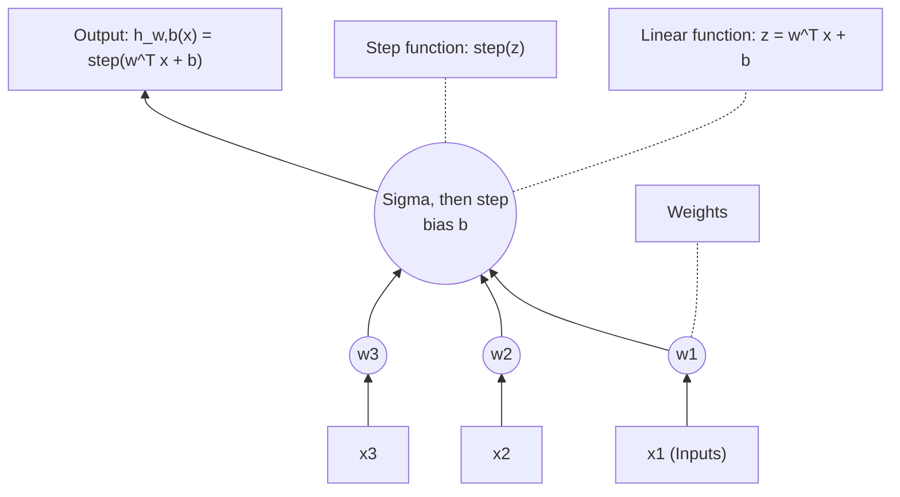
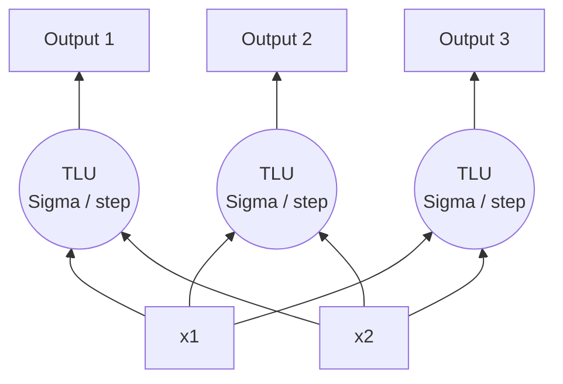
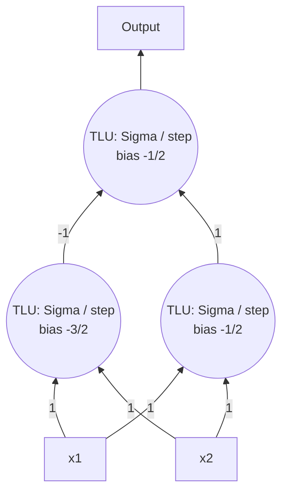
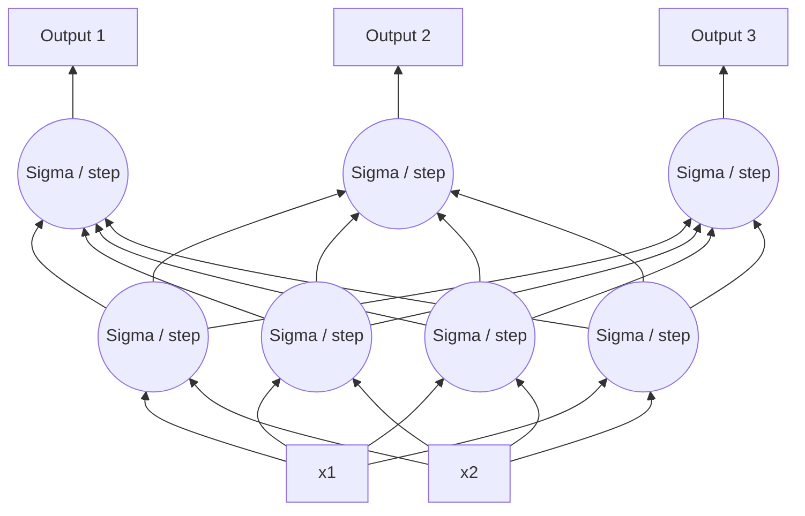
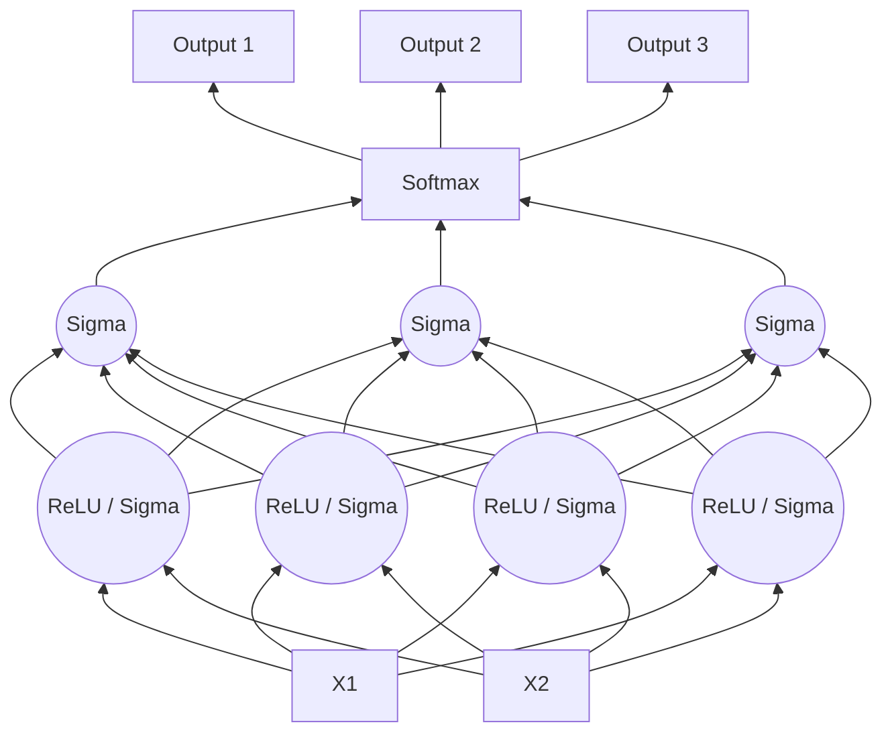
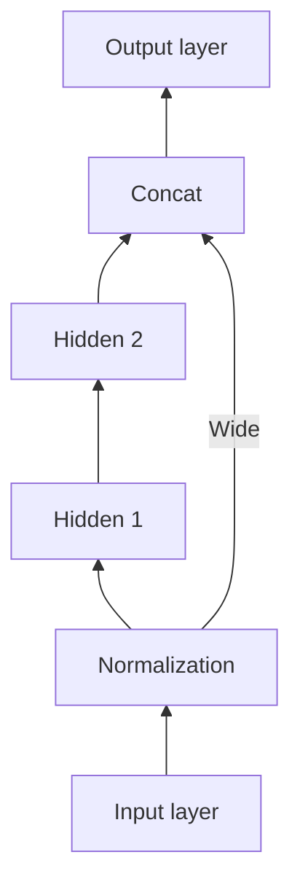
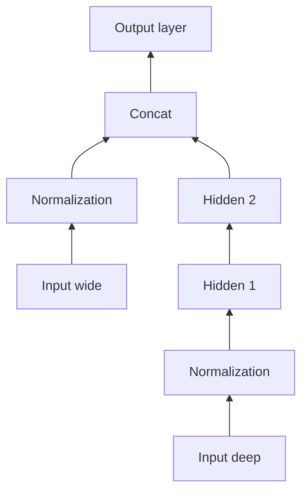
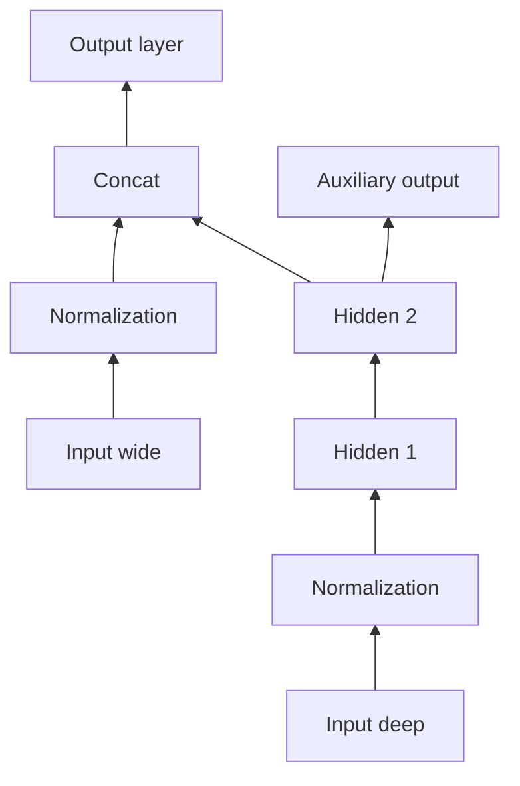

# CITS5017 Deep Learning — Topic 1: Introduction to Artificial Neural Networks

*Associate Professor Du Huynh (Unit Coordinator and Lecturer) — Semester 2, 2026 — The University of Western Australia*

---

## Slide 1 — CITS5017 Deep Learning / Topic 1: Introduction to Artificial Neural Networks

CITS5017 Deep Learning
Topic 1: Introduction to Artificial Neural Networks

Associate Professor Du Huynh
(Unit Coordinator and Lecturer)

Semester 2, 2026


> **Figure 1.** Title-slide branding. The UWA shield is quartered: two open books in the upper quarters carrying the mottos "VIT AM" / "EXC OLU" and "ERE PER" / "AR TES" (i.e. *vitam excolere per artes*), and a black swan on a gold field in the lower half. A banner beneath the shield reads "SEEK WISDOM". Below the crest, the wordmark reads "THE UNIVERSITY OF WESTERN AUSTRALIA".

---

## Slide 2 — Today

Chapters 10.

### Hands-on Machine Learning with Scikit-Learn, Keras & TensorFlow


> **Figure 2.** Photograph of the O'Reilly book cover. Text on the cover, top to bottom: publisher mark "O'REILLY®"; a corner flash reading "Third Edition"; title "Hands-On Machine Learning with Scikit-Learn, Keras & TensorFlow"; subtitle "Concepts, Tools, and Techniques to Build Intelligent Systems"; "powered by" followed by a Jupyter logo; author "Aurélien Géron". The cover illustration is a black-and-orange spotted salamander (fire salamander) walking across the lower two-thirds of the cover.

---

## Slide 3 — Chapter Ten

### Introduction to Artificial Neural Networks

Here are the main topics we will cover:

- Perceptrons and threshold logic unit (TLU)
- Training of a Perceptron and Hebb's rule
- Perceptrons and the XOR classification problem
- Multi-Layer Perceptrons (MLP) and backpropagation
- Commonly used activation functions
- Training a deep neural network (DNN) using the Sequential API
- Training a deep neural network (DNN) using the Functional API
- Fine-tuning neural network hyperparameters

---

## Slide 4 — The Perceptron

- The *Perceptron* is one of the simplest ANN architectures, invented in 1957 by Frank Rosenblatt.
- It is based on a slightly different artificial neuron called a *threshold logic unit* (TLU), where the inputs and output are numbers (instead of binary on/off values) and each input connection is associated with a **weight**. [highlighted red]
- The TLU computes a weighted sum of its inputs: $z = w_1x_1 + \cdots + w_nx_n + b = \mathbf{w}^T\mathbf{x} + b$. It then applies a *step function* to that sum and outputs the result: $h_{\mathbf{w},b}(\mathbf{x}) = \text{step}(z)$.



> **Figure 10-4.** Threshold Logic Unit (TLU) or sometimes Linear Threshold Unit (LTU).
> Diagram contents: three inputs labelled $x_1$, $x_2$, $x_3$ at the bottom (annotated "Inputs", green). Each input feeds a small circle labelled $w_1$, $w_2$, $w_3$ respectively (annotated "Weights", orange). All three weighted connections converge with arrows into a single blue neuron drawn as a circle split horizontally: the lower half contains a summation symbol $\Sigma$ (annotated "Linear function: $z=\mathbf{w}^\mathsf{T}\mathbf{x}+b$") and the upper half contains a step-function glyph (annotated "Step function: step($z$)"). A small circle labelled $b$ sits on the right of the neuron (the bias). A single arrow leaves the top of the neuron, annotated "Output: $h_{\mathbf{w},b}(\mathbf{x})=\text{step}(\mathbf{w}^\mathsf{T}\mathbf{x}+b)$".

---

## Slide 5 — The Perception (cont.)

### Step Functions

The most common step function used in Perceptrons is the Heaviside step function:

$$
\text{heaviside}(z) =
\begin{cases}
0 & \text{if } z < 0 \\
1 & \text{if } z \ge 0
\end{cases}
$$

Sometimes the sign function is used instead:

$$
\text{sign}(z) =
\begin{cases}
-1 & \text{if } z < 0 \\
0 & \text{if } z = 0 \\
+1 & \text{if } z > 0
\end{cases}
$$

---

## Slide 6 — The Perceptron (cont.)

A single TLU can be used for simple linear binary classification: It computes a linear combination of the inputs and if the result exceeds a threshold, it outputs the positive class or else outputs the negative class (just like a Logistic Regression classifier or a linear SVM).

A Perceptron is simply composed of one or more TLUs organised in a single layer, where

- every TLU is connected to every input. Such a layer is called a *fully connected layer*, or a *dense layer*;
- the inputs constitute the *input layer*; and
- since the layer of TLUs produces the final outputs, it is called the *output layer*.

---

## Slide 7 — Perceptron: An example



> **Figure 10-5.** A Perceptron with two input and three output neurons.
> Diagram contents: at the bottom, two inputs labelled $x_1$ and $x_2$, annotated "Inputs" (green text) and enclosed by a dashed green bracket labelled "Input layer". Each input connects by an arrow to every one of three blue circular TLUs (each circle split horizontally with $\Sigma$ below and a step-function glyph above), so six connections in total, drawn crossing over each other. The leftmost neuron is annotated "TLU" (black label to its left). The three neurons are enclosed by a dashed blue bracket labelled "Output layer". Each neuron has a single upward arrow leaving it; collectively these are annotated "Outputs" (blue text) at the top.

---

## Slide 8 — Perceptron: Computing the outputs

The magic of linear algebra makes it possible to efficiently compute the outputs of a fully connected layer:

$$
h_{\mathbf{W},\mathbf{b}}(\mathbf{X}) = \phi(\mathbf{X}\mathbf{W} + \mathbf{b}^\top)
$$

where

- $\mathbf{X}$ represents the matrix of input features (one row per instance, one column per feature)
- $\mathbf{W}$ represents the unknown weight matrix which contains all the connection weights (one row per input feature and one column per neuron)
- $\mathbf{b}$ is the bias vector (one per neuron).
- $\phi$ is called the *activation function*

> **Figure (repeated, slide 8).** The same diagram as Figure 10-5 is inset at the top right: two inputs $x_1$, $x_2$ annotated "Inputs" inside a dashed green bracket labelled "Input layer"; three fully connected blue TLUs (each with $\Sigma$ and a step glyph) labelled "TLU" on the left and enclosed by a dashed blue bracket labelled "Output layer"; three upward arrows at the top annotated "Outputs".

---

## Slide 9 — How is a Perceptron trained?

The Perceptron training algorithm proposed by Frank Rosenblatt was largely inspired by *Hebb's rule* or *Hebbian learning* (name after Donald Hebb) which can be summarized as "cells that fire together, wire together".

More specifically, the Perceptron is fed one training instance at a time, and for each instance it makes its predictions. For every output neuron that produced a wrong prediction, it reinforces the connection weights from the inputs that would have contributed to the correct prediction.

---

## Slide 10 — How is a Perceptron trained? (cont.)

Perceptron learning rule (weight update):

$$
w_{i,j}^{(\text{next step})} = w_{i,j} + \eta\left(y_j - \hat{y}_j\right)x_i
$$

where

- $w_{i,j}$ is the connection weight between the $i^{\text{th}}$ input neuron and the $j^{\text{th}}$ output neuron.
- $x_i$ is the $i^{\text{th}}$ input value of the current training instance.
- $\hat{y}_j$ is the output of the $j^{\text{th}}$ output neuron for the current training instance.
- $y_j$ is the target output of the $j^{\text{th}}$ output neuron for the current training instance.
- $\eta$ is the learning rate.

---

## Slide 11 — How is a Perceptron trained? (cont.)

Printed (typeset) equation:

$$
w_{i,j}^{(\text{next step})} = w_{i,j} + \eta\left(y_j - \hat{y}_j\right)x_i
$$

**Handwritten annotations** (in red, purple, green and highlighted colours) follow.

Boxed in red:

$$
w_{i,j}^{(\text{next step})} = w_{i,j} - \eta\left(\hat{y}_j - y_j\right)x_i
$$

The **loss** [highlighted yellow] that we try to minimise is $\tfrac{1}{2}\left(\hat{y}_j - y_j\right)^2$ [highlighted yellow] where $\hat{y}_j = \sum\limits_{i=1}^{n} x_i\, w_{i,j}$ (assuming that $W \in \mathbb{R}^{n \times m}$)

Labelled *(error)* [green], and the derivative labelled *(error gradient w.r.t. $w_{ij}$)* [green]:

$$
\mathcal{L}_j = \frac{1}{2}\left(\hat{y}_j - y_j\right)^2
\quad \Rightarrow \quad
\frac{\partial \mathcal{L}_j}{\partial w_{i,j}} = \left(\hat{y}_j - y_j\right)\frac{\partial \hat{y}_j}{\partial w_{i,j}}
$$

Now

$$
\begin{aligned}
\frac{\partial \hat{y}_j}{\partial w_{i,j}}
&= \frac{\partial}{\partial w_{i,j}}\left(\sum_{i=1}^{n} x_i\, w_{i,j}\right) \\
&= \frac{\partial}{\partial w_{i,j}}\left(x_1 w_{1,j} + x_2 w_{2,j} + \cdots\; x_i w_{i,j} + \cdots\; x_n w_{n,j}\right) = x_i
\end{aligned}
$$

$$
\Rightarrow \quad \frac{\partial \mathcal{L}_j}{\partial w_{i,j}} = \left(\hat{y}_j - y_j\right)x_i
$$

[highlighted green; underbraced with the note "error gradient for $w_{ij}$"]

Boxed in red, with the underbrace note "negative error gradient scaled by the learning rate.":

$$
w_{i,j}^{(\text{next step})} = w_{i,j} - \eta\, \frac{\partial \mathcal{L}_j}{\partial w_{i,j}}
$$

> **Figure 11 (hand-drawn, top right).** A single-layer network sketched in red. Along the top row is a row of small circles representing output neurons; the $j^{\text{th}}$ one is marked and labelled $\hat{y}_j$ above it, with two unlabelled circles and an ellipsis to its left, and an ellipsis and one further circle to its right. Along the bottom row are input nodes drawn as larger circles, labelled $x_1$, $x_2$, $x_3$, $\cdots$, $x_i$, $\cdots$, $x_n$. Straight edges fan from each input up to the $j^{\text{th}}$ output neuron, labelled (left to right) $w_{1,j}$, $w_{2,j}$, $w_{3,j}$, $w_{i,j}$, $w_{n,j}$.

---

## Slide 12 — Perceptron: Decision Boundary

The decision boundary of each output neuron is linear, so Perceptrons (just like Logistic Regression classifiers) are incapable of learning complex patterns.

However, if the training instances are linearly separable, Rosenblatt demonstrated that this algorithm would converge to a solution.[^1] This is called the *Perceptron convergence theorem*.

[^1]: Note that this solution is generally not unique.

---

## Slide 13 — Implementing Perceptron in Scikit-Learn

Scikit-Learn provides a `Perceptron` class that implements a single TLU network:

```python
import numpy as np
from sklearn.datasets import load_iris
from sklearn.linear_model import Perceptron
iris = load_iris()
X = iris.data[:, (2, 3)]                # petal length, petal width
y = (iris.target == 0).astype(np.int)   # Iris Setosa?
per_clf = Perceptron(random_state=42)
per_clf.fit(X, y)
y_pred = per_clf.predict([[2, 0.5], [3, 1]]) # predicts True and False
```

> **Figure 13.** Scatter plot with a filled decision-region background. Chart type: 2-D scatter plot with two shaded half-planes separated by a solid black straight line. Horizontal axis: "Petal length", ticks at 0, 1, 2, 3, 4, 5. Vertical axis: "Petal width", ticks at 0.00, 0.25, 0.50, 0.75, 1.00, 1.25, 1.50, 1.75, 2.00. The region below/left of the boundary line is shaded pale yellow; the region above/right is shaded pale blue/lavender. The solid black decision boundary runs from roughly $(0, 1.8)$ at the left edge down to roughly $(2.9, 0)$ on the horizontal axis. Legend (lower right): a blue square marker for "Not Iris-Setosa" and an olive/yellow circle marker for "Iris-Setosa". Series 1 (blue squares, "Not Iris-Setosa") forms a broad upward-trending cloud in the blue region, spanning roughly petal length 3.0 to 5.0 and petal width 1.0 to 2.0, with the densest clustering around petal length 4.0–5.0 and petal width 1.2–1.9. Series 2 (olive circles, "Iris-Setosa") forms a tight cluster in the yellow region around petal length 1.0–2.0 and petal width 0.1–0.6. No individual data values are printed on the plot.
> Original caption: "Decision boundary output by the code above."

---

## Slide 14 — Implementing Perceptron in Scikit-Learn (cont.)

The Perceptron learning algorithm strongly resembles Stochastic Gradient Descent. In fact, Scikit-Learn's `Perceptron` class is equivalent to using an `SGDClassifier` with the following hyperparameters:

- `loss="perceptron"`,
- `learning_rate="constant"`,
- `eta0=1` (learning rate), and
- `penalty=None` (no regularization).

---

## Slide 15 — Comparing Perceptron with Logistic Regression Classifiers

Note that contrary to Logistic Regression classifiers, Perceptrons do not output a class probability; rather, they just make predictions based on a hard threshold.

This is one of the good reasons to prefer Logistic Regression over Perceptrons.

---

## Slide 16 — Weaknesses of Perceptrons

In their 1969 monograph titled "*Perceptrons*", **Marvin Minsky** and **Seymour Papert** [highlighted red] highlighted some serious weaknesses of Perceptrons, in particular, their inability of solving some trivial problems (e.g., the *Exclusive OR* (XOR) classification problem).

Of course this is true of any other linear classification model as well (such as **Logistic Regression classifiers** [highlighted red]), but researchers had expected much more from Perceptrons. As a result, many researchers dropped *connectionism* altogether.

> **Figure 10-6a.** XOR classification problem.
> Diagram contents: a 2-D plot with a horizontal axis labelled $x_1$ and a vertical axis labelled $x_2$. Tick labels: `0` at the origin on both axes (the origin shows `0` on the vertical axis and `0` below the horizontal axis), `1` on the vertical axis and `1` on the horizontal axis. Four instances are plotted at the corners of the unit square:
> - $(0,0)$: red/dark-red triangle
> - $(0,1)$: green square
> - $(1,0)$: green square
> - $(1,1)$: red/dark-red triangle
>
> Thin dashed lines join $(0,1)$ horizontally to $(1,1)$ and $(1,1)$ vertically down to $(1,0)$. Two parallel diagonal dashed lines of negative slope run across the plot, with the pale-green band between them containing the two green squares; the two red triangles lie outside the band on opposite sides. This illustrates that no single straight line can separate the green squares from the red triangles.

---

## Slide 17 — Weaknesses of Perceptrons (cont.)

However, it turns out that some of the limitations of Perceptrons can be eliminated by stacking multiple Perceptrons. The resulting ANN is called a *Multi-Layer Perceptron* (MLP).

In particular, an MLP can solve the XOR problem, as you can verify by computing the output of the MLP for each combination of inputs:

- with inputs (0, 0) or (1, 1) the network outputs 0;
- with inputs (0, 1) or (1, 0) it outputs 1.



> **Figure 10-6b.** An MLP that solves the XOR classification problem.
> Diagram contents: two inputs $x_1$ (left) and $x_2$ (right) at the bottom, in green. Each input passes through a small circle labelled `1` (the connection weight) and connects, with the connections crossing over, to both of two hidden TLUs (blue circles split horizontally with $\Sigma$ below and a step glyph above), labelled "TLU" on the left of the row. The left hidden TLU carries a small circle labelled $-\tfrac{3}{2}$ on its right (its bias); the right hidden TLU carries a small circle labelled $-\tfrac{1}{2}$. The two intermediate weight circles labelled `1` and `1` sit between the input row and the hidden row on the crossing connections. Each hidden TLU connects upward to a single output TLU (same split-circle style) whose bias circle is labelled $-\tfrac{1}{2}$; the connection from the left hidden unit is labelled $-1$ and the connection from the right hidden unit is labelled $1$. A single arrow leaves the top of the output TLU.

---

## Slide 18 — Multi-Layer Perceptron and Backpropagation

An MLP is composed of one (passthrough) *input layer*, one or more layers of TLUs, called *hidden layers*, and one final layer of TLUs called the *output layer*.



> **Figure 10-7.** Multi-Layer Perceptron.
> Diagram contents: bottom row, two green inputs labelled $X_1$ and $X_2$, enclosed by a dashed green bracket labelled "Input layer". Middle row, four blue TLU circles (each split horizontally, $\Sigma$ below, step glyph above), fully connected from both inputs (eight upward arrows crossing), enclosed by a dashed black bracket labelled "Hidden layer". Top row, three blue TLU circles of the same style, fully connected from all four hidden units (twelve upward arrows crossing), enclosed by a dashed blue bracket labelled "Output layer". Each output TLU has one upward arrow leaving it.

---

## Slide 19 — Multi-Layer Perceptron and Backpropagation (cont.)

We can describe the backpropagation training algorithm[^2] as Gradient Descent using reverse-mode autodiff.

For each training instance, the algorithm

- feeds it to the network and computes the output of every neuron in each layer (this is the *forward pass*),
- measures the network's output error (i.e., the difference between the desired output and the actual output of the network),
- goes through each layer in reverse order to measure the error contribution from each connection (this is the *reverse pass*) until the input layer is reached, and
- finally slightly tweaks the connection weights to reduce the error (this is the Gradient Descent step).

[^2]: "Learning Internal Representations by Error Propagation," D. Rumelhart, G. Hinton, R. Williams (1986). This algorithm was actually invented several times, starting with P. Werbos in 1974.

---

## Slide 20 — Multi-Layer Perceptron and Backpropagation (cont.)

### Activation functions

In order for the backpropagation training algorithm to work, Rumelhart et al made a key change to the MLP's architecture: they replaced the step function with the logistic function, $\sigma(z) = 1/(1 + \exp(-z))$, also called the *sigmoid* function. This was essential because the step function has no gradient to work with, while the logistic function has a well-defined nonzero derivative everywhere.

Such a function which defines the output of a neuron (or node) given an input or set of inputs is known as the *activation function*.

(The derivative is:

$$
\begin{aligned}
\sigma'(z) &= \frac{\exp(-z)}{\left(1+\exp(-z)\right)^2} = \frac{1+\exp(-z)-1}{\left(1+\exp(-z)\right)^2} \\
&= \frac{1}{1+\exp(-z)} - \frac{1}{\left(1+\exp(-z)\right)^2} \\
&= \sigma(z) - \sigma^2(z) = \sigma(z)\left(1 - \sigma(z)\right)
\end{aligned}
$$

)

---

## Slide 21 — Multi-Layer Perceptron and Backpropagation (cont.)

### Activation functions

Apart from the logistic function, two other popular activation functions are:

- The *hyperbolic tangent* function: $\tanh(z) = 2\sigma(2z) - 1$. This function has a similar S shape as the logistic function, is continuous and differentiable, but its values range from $-1$ to $+1$.
- The *rectified linear unit* function: $\text{ReLU}(z) = \max(0, z)$. This function is continuous but unfortunately not differentiable everywhere. However, in practice it works very well and has the advantage of being fast to compute. Most importantly, the fact that it does not have a maximum output value also helps reduce some issues during Gradient Descent.

---

## Slide 22 — Multi-Layer Perceptron and Backpropagation (cont.)

### Activation functions

> **Figure 10-8.** Activation functions and their derivatives.
> Two side-by-side line plots.
>
> **Left panel — title "Activation functions".** Horizontal axis unlabelled, ticks at $-4, -3, -2, -1, 0, 1, 2, 3, 4$ (plot extends to about $\pm 4.5$). Vertical axis unlabelled, ticks at $-1, 0, 1, 2$. Grid lines shown. Four series, per the legend:
> - **Heaviside** — solid red: flat at $0$ for $z<0$, a vertical jump at $z=0$, then flat at $1$ for $z\ge 0$.
> - **ReLU** — magenta dash-dot: flat at $0$ for $z<0$, then a straight line of slope 1 rising off the top of the axes past $2$ at about $z=2.4$.
> - **Sigmoid** — green dashed: smooth S-curve from $0$ at the left to $1$ at the right, passing through $0.5$ at $z=0$.
> - **Tanh** — thin blue solid: smooth S-curve from $-1$ at the left to $1$ at the right, passing through $0$ at $z=0$, steeper than the sigmoid.
>
> **Right panel — title "Derivatives".** Horizontal axis unlabelled, ticks at $-4, -3, -2, -1, 0, 1, 2, 3, 4$. Vertical axis ticks at $-0.2, 0.0, 0.2, 0.4, 0.6, 0.8, 1.0, 1.2$. Grid lines shown. Same four series (legend shared with the left panel):
> - Heaviside derivative — solid red: flat at $0.0$ everywhere, with a red cross/marker at $(0, 0.0)$ marking the undefined point.
> - ReLU derivative — magenta dash-dot: flat at $0.0$ for $z<0$, a vertical dash-dot segment at $z=0$ rising to $1.0$ (with a magenta cross marker at $(0, 1.0)$), then flat at $1.0$ for $z>0$.
> - Sigmoid derivative — green dashed: bell-shaped curve peaking at $0.25$ at $z=0$ and decaying towards $0$ at both ends.
> - Tanh derivative — thin blue solid: taller, narrower bell-shaped curve peaking at $1.0$ at $z=0$ and decaying towards $0$ at both ends.

---

## Slide 23 — Multi-Layer Perceptron and Backpropagation (cont.)

### Why do we need activation functions?

Consider two linear functions for your two layers $f(z) = 2z + 3$ and $g(z) = 5z - 1$. If you chain them together, you get $f(g(z)) = 2(5z - 1) + 3 = 10z + 1$, which is a linear function. If you don't have some nonlinearity between layers, then even a deep stack of layers is equivalent to a single layer, and you can't solve very complex problems with that.

---

## Slide 24 — Regression MLPs

MLPs can be used for regression tasks. For example, to predict the price of a house given many of its features, you need one output neuron. For multivariate regression, you need multiple neurons.

For regression, the output neurons usually do not need an activation function. Only when the output $z$ needs to be

- always positive, then use the ReLU or $\text{softplus}(z) = \log(1 + \exp(z))$ activation function;
- in a certain range of values, then use logistic or hyperbolic tangent and then scale the value to the required range.

---

## Slide 25 — Regression MLPs (cont.)

The `softplus` function is like the `ReLU` function except that it is smooth at the origin:

$$
\begin{aligned}
\text{ReLU}(z) &= \max(0, z) \\
\text{softplus}(z) &= \log(1 + \exp(z))
\end{aligned}
$$

> **Figure 25.** Line plot comparing two activation functions. Horizontal axis labelled $z$, ticks at $-4, -2, 0, 2, 4$ (plot range about $-5$ to $5$). Vertical axis unlabelled, ticks at $-1, 0, 1, 2, 3, 4, 5, 6$. Grid lines shown. Legend (upper left): red solid line = $\text{ReLU}(z)$; blue solid line = $\text{softplus}(z)$. The ReLU series is flat at $0$ for $z \le 0$ and then rises linearly with slope 1, reaching about $5$ at $z=5$. The softplus series is slightly above $0$ on the far left, curves smoothly upward through about $0.69$ at $z=0$, and asymptotically merges with the ReLU line for $z \gtrsim 3$, reaching about $5$ at $z=5$.

---

## Slide 26 — Regression MLPs (cont.)

### An example

```python
from sklearn.datasets import fetch_california_housing
from sklearn.metrics import mean_squared_error
from sklearn.model_selection import train_test_split
from sklearn.neural_network import MLPRegressor
from sklearn.pipeline import make_pipeline
from sklearn.preprocessing import StandardScaler

housing = fetch_california_housing()
X_train_full, X_test, y_train_full, y_test = train_test_split(
    housing.data, housing.target, random_state=42)
X_train, X_valid, y_train, y_valid = train_test_split(
    X_train_full, y_train_full, random_state=42)

# 3 hidden layers with 50 neurons per layer
mlp_reg = MLPRegressor(hidden_layer_sizes=[50, 50, 50], random_state=42)
pipeline = make_pipeline(StandardScaler(), mlp_reg)
pipeline.fit(X_train, y_train)
y_pred = pipeline.predict(X_valid)
rmse = mean_squared_error(y_valid, y_pred, squared=False)   # around 0.505
```

The median house prices (the $y$ values) have been normalised to the range $[0, 5]$, so the RMSE $0.505$ is equivalent to around 10% error.

---

## Slide 27 — Regression MLPs (cont.)

The loss function to use during training is typically the **mean squared error** or **mean absolute error** (the latter is more robust against outliers). Alternatively, the **Huber loss**, which is a combination of MSE and MAE, can also be used. [key terms in red]

### Typical regression MLP architecture:

| Hyperparameter | Typical value |
| --- | --- |
| # hidden layers | Depends on the problem, but typically 1 to 5 |
| # neurons per hidden layer | Depends on the problem, but typically 10 to 100 |
| # output neurons | 1 per prediction dimension |
| Hidden activation | ReLU |
| Output activation | None, or ReLU/softplus (if positive outputs) or sigmoid/tanh (if bounded outputs) |
| Loss function | MSE, or Huber if outliers |

---

## Slide 28 — Regression MLPs (cont.)

The *Huber* loss behaves like the *absolute error* loss when the input $z$ is large and behaves like the *squared error* loss when the input $z$ is small.

$$
\text{Huber}_\delta(z) =
\begin{cases}
\frac{1}{2}z^2 & \text{if } |z| \le \delta \\
\delta\left(|z| - \frac{1}{2}\delta\right) & \text{otherwise}
\end{cases}
$$

> **Figure 28.** Two side-by-side line plots.
>
> **Left panel — title "Absolute and squared errors".** Horizontal axis labelled $z$, ticks at $-4, -2, 0, 2, 4$. Vertical axis labelled "Loss_function(z)", ticks at $0, 2, 4, 6, 8, 10$. Grid lines shown. Legend (upper centre): green dashed = "abs. error"; blue solid = "sq. error". The absolute-error series is a V shape with vertex at $(0,0)$, reaching about $4.3$ at $z = \pm 4.4$. The squared-error series is an upward parabola with vertex at $(0,0)$, rising steeply and leaving the top of the plot at about $z = \pm 3.2$ (value 10).
>
> **Right panel — title "$\text{Huber}_\delta(z)$".** Horizontal axis labelled $z$, ticks at $-4, -2, 0, 2, 4$. Vertical axis labelled "Loss_function(z)", ticks at $0, 2, 4, 6, 8, 10$. Grid lines shown. Legend (upper right): red solid = "$\delta = 1$"; blue dash-dot = "$\delta = 2$". The $\delta = 1$ curve is quadratic near the origin and becomes linear beyond $|z| = 1$, reaching about $4.0$ at $z = \pm 4.4$. The $\delta = 2$ curve is quadratic over a wider region near the origin and becomes linear (with steeper slope) beyond $|z| = 2$, reaching about $7.0$ at $z = \pm 4.4$.

---

## Slide 29 — Classification MLPs

MLPs can also be used for classification tasks.

- For **binary classification** problems, one single output neuron with a logistic activation function would be sufficient.
- For **multilabel classification** problems, you can have multiple output neurons, each with a logistic activation function.
- For **multiclass classification** problems (e.g., MNIST dataset), you can have multiple output neurons, with the **softmax** activation function. This will ensure that all the output values are probabilities and they sum to 1.

For the loss function, since we are predicting probability distributions, the **cross-entropy loss** (also called the *log loss*) is generally a good choice:

$$
J(\boldsymbol{\theta}) = -\frac{1}{m}\sum_{i=1}^{m}\sum_{k=1}^{K} y_k^{(i)} \log\left(\hat{p}_k^{(i)}\right)
$$

where $K$ denotes the total number of classes (e.g., $K = 10$ for MNIST).

---

## Slide 30 — Classification MLPs (cont.)



> **Figure 10-9.** A modern MLP (including ReLU and softmax) for classification.
> Diagram contents: bottom row, two green inputs labelled $X_1$ and $X_2$, enclosed by a dashed green bracket labelled "Input layer". Middle row, four blue circles split horizontally with $\Sigma$ below and a ReLU (bent-line) glyph above; an arrow with the black label "ReLU" points at the ReLU glyph of the leftmost hidden unit. This row is fully connected from the two inputs (eight crossing arrows) and enclosed by a dashed black bracket labelled "Hidden layer". Top row, three blue circles containing only $\Sigma$, fully connected from the four hidden units (twelve crossing arrows), enclosed by a dashed blue bracket labelled "Output layer". Above the three output units sits a single wide peach/cream rectangle labelled "Softmax", with three upward arrows leaving its top.

---

## Slide 31 — Classification MLPs (cont.)

### Typical classification MLP architecture:

<table>
  <thead>
    <tr>
      <th>Hyperparameter</th>
      <th>Binary classification</th>
      <th>Multilabel binary classification</th>
      <th>Multiclass classification</th>
    </tr>
  </thead>
  <tbody>
    <tr>
      <td># hidden layers</td>
      <td colspan="3">Typically 1 to 5 layers, depending on the task</td>
    </tr>
    <tr>
      <td># output neurons</td>
      <td>1</td>
      <td>1 per binary label</td>
      <td>1 per class</td>
    </tr>
    <tr>
      <td>Output layer activation</td>
      <td>Sigmoid</td>
      <td>Sigmoid</td>
      <td>Softmax</td>
    </tr>
    <tr>
      <td>Loss function</td>
      <td>X-entropy</td>
      <td>X-entropy</td>
      <td>X-entropy</td>
    </tr>
  </tbody>
</table>

---

## Slide 32 — Implementing MLPs with Keras

Keras (`https://keras.io/`) is a high-level Deep Learning API that allows you to easily build, train, evaluate, and execute all sorts of neural networks.

It was developed by François Chollet and was released as an open source project in March 2015. It quickly gained popularity and, at present, is available in three popular open source Deep Learning libraries: TensorFlow, Microsoft Cognitive Toolkit (CNTK), and Theano. We will refer to this reference implementation as *multibackend Keras*. However, since version 2.4, Keras is TensorFlow-only.

---

## Slide 33 — Implementing MLPs with Keras (cont.)

After installation, check that you have the correct version of TensorFlow for the unit:

```python
import tensorflow as tf
from tensorflow import keras
tf.__version__
# output: '2.17.0'
keras.__version__
# output: '3.10.0'
```

---

## Slide 34 — Example: Building an Image Classifier Using the Sequential API

A linear model can reach about $92\%$ on MNIST, but only about $83\%$ on *Fashion MNIST*, which also has $10$ classes with input being $28 \times 28$ images:


> **Figure 10-11.** Samples from Fashion MNIST.
> Diagram contents: a grid of 40 small greyscale clothing images in 4 rows of 10, each with its class name printed above it.
> - Row 1: Ankle boot, T-shirt/top, T-shirt/top, Dress, T-shirt/top, Pullover, Sneaker, Pullover, Sandal, Sandal
> - Row 2: T-shirt/top, Ankle boot, Sandal, Sandal, Sneaker, Ankle boot, Trouser, T-shirt/top, Shirt, Coat
> - Row 3: Dress, Trouser, Coat, Bag, Coat, Dress, T-shirt/top, Pullover, Coat, Coat
> - Row 4: Sandal, Dress, Shirt, Shirt, T-shirt/top, Bag, Sandal, Pullover, Trouser, Shirt

The 10 classes are: "T-shirt/top", "Trouser", "Pullover", "Dress", "Coat", "Sandal", "Shirt", "Sneaker", "Bag", and "Ankle boot".

---

## Slide 35 — Example: Building an Image Classifier Using the Sequential API (cont.)

### Loading the data and creating the model

```python
import tensorflow as tf

fashion_mnist = tf.keras.datasets.fashion_mnist.load_data()
(X_train_full, y_train_full), (X_test, y_test) = fashion_mnist   #60,000 and 10,000
# split training set to form a validation set (last 5000 instances)
X_train, y_train = X_train_full[:-5000], y_train_full[:-5000]
X_valid, y_valid = X_train_full[-5000:], y_train_full[-5000:]
# scale pixel intensities to the 0..1 range
X_train, X_valid, X_test = X_train / 255., X_valid / 255., X_test / 255.

# creating the model
model = tf.keras.Sequential()
model.add(tf.keras.layers.InputLayer(shape=[28, 28]))
model.add(tf.keras.layers.Flatten())
model.add(tf.keras.layers.Dense(300, activation="relu"))
model.add(tf.keras.layers.Dense(100, activation="relu"))
model.add(tf.keras.layers.Dense(10, activation="softmax"))
```

The last few lines above can be replaced by

```python
model = tf.keras.Sequential([
    tf.keras.layers.InputLayer(shape=[28, 28]),
    tf.keras.layers.Flatten(),
    tf.keras.layers.Dense(300, activation="relu"),
    tf.keras.layers.Dense(100, activation="relu"),
    tf.keras.layers.Dense(10, activation="softmax")
])
```

---

## Slide 36 — Example: Building an Image Classifier Using the Sequential API (cont.)

### Inspecting the model

```python
>>> model.summary()
```

`Model: "sequential_1"`

| Layer (type) | Output Shape | Param # |
|---|---|---|
| flatten_1 (Flatten) | (None, 784) | 0 |
| dense_3 (Dense) | (None, 300) | 235,500 |
| dense_4 (Dense) | (None, 100) | 30,100 |
| dense_5 (Dense) | (None, 10) | 1,010 |

`Total params: 266,610 (1.02 MB)`

`Trainable params: 266,610 (1.02 MB)`

`Non-trainable params: 0 (0.00 B)`

> **Figure (screenshot).** The table above is a screenshot of a Keras 3 `model.summary()` output, drawn with rectangular cell borders and three columns headed "Layer (type)", "Output Shape" and "Param #". Layer type names (`Flatten`, `Dense`) appear in blue inside parentheses, `None` in cyan, and the shape sizes and parameter counts in green.

```python
>>> hidden1 = model.layers[1]
>>> hidden1.name
'dense_3'
>>> weights, biases = hidden1.get_weights()
.......
>>> weights.shape
(784, 300)
>>> biases.shape
(300,)
```

---

## Slide 37 — Example: Building an Image Classifier Using the Sequential API (cont.)

### Compiling the model

```python
model.compile(loss="sparse_categorical_crossentropy", optimizer="sgd", metrics=["accuracy"])
```

### Training and evaluating the model

```python
>>> history = model.fit(X_train, y_train, epochs=30, validation_data=(X_valid, y_valid))
```

```text
1719/1719 ━━━━━━━━━━━━━━━━━━━━ 5s 2ms/step - loss: 1.0023 - sparse_categorical_accuracy: 0.6816 - val_loss: 0.5075 - val_sparse_cate
gorical_accuracy: 0.8246
Epoch 2/30
1719/1719 ━━━━━━━━━━━━━━━━━━━━ 3s 2ms/step - loss: 0.5057 - sparse_categorical_accuracy: 0.8262 - val_loss: 0.4561 - val_sparse_cate
gorical_accuracy: 0.8370
Epoch 3/30
1719/1719 ━━━━━━━━━━━━━━━━━━━━ 3s 2ms/step - loss: 0.4536 - sparse_categorical_accuracy: 0.8418 - val_loss: 0.4306 - val_sparse_cate
gorical_accuracy: 0.8446
Epoch 4/30
1719/1719 ━━━━━━━━━━━━━━━━━━━━ 3s 2ms/step - loss: 0.4236 - sparse_categorical_accuracy: 0.8514 - val_loss: 0.4160 - val_sparse_cate
gorical_accuracy: 0.8514
```

. . .   . . .

```text
Epoch 27/30
1719/1719 ━━━━━━━━━━━━━━━━━━━━ 3s 2ms/step - loss: 0.2352 - sparse_categorical_accuracy: 0.9161 - val_loss: 0.3454 - val_sparse_cate
gorical_accuracy: 0.8762
Epoch 28/30
1719/1719 ━━━━━━━━━━━━━━━━━━━━ 3s 2ms/step - loss: 0.2311 - sparse_categorical_accuracy: 0.9180 - val_loss: 0.3451 - val_sparse_cate
gorical_accuracy: 0.8760
Epoch 29/30
1719/1719 ━━━━━━━━━━━━━━━━━━━━ 3s 2ms/step - loss: 0.2270 - sparse_categorical_accuracy: 0.9195 - val_loss: 0.3456 - val_sparse_cate
gorical_accuracy: 0.8768
Epoch 30/30
1719/1719 ━━━━━━━━━━━━━━━━━━━━ 3s 2ms/step - loss: 0.2231 - sparse_categorical_accuracy: 0.9217 - val_loss: 0.3441 - val_sparse_cate
gorical_accuracy: 0.8776
```

> **Figure (screenshot).** The training log above is a screenshot of Keras output in a small monospace font. Each progress bar is drawn as a solid green line after the bold step count "1719/1719", and the epoch time ("5s", "3s") is bold. The first epoch's "Epoch 1/30" header is not shown. Each line is wrapped mid-word ("val_sparse_cate" / "gorical_accuracy"). Epochs 5–26 are replaced by a blue ". . .   . . ." between the two halves.

Useful options to include when calling the `fit` method: `class_weight`, `sample_weight`, `batch_size` (default=32)

---

## Slide 38 — Example: Building an Image Classifier Using the Sequential API (cont.)

### Inspecting the learning curves

```python
import matplotlib.pyplot as plt
import pandas as pd

pd.DataFrame(history.history).plot(
    figsize=(8, 5), xlim=[0, 29], ylim=[0, 1], grid=True, xlabel="Epoch",
    style=["r--", "r--.", "b-", "b-*"])
plt.legend(loc="lower left")  # extra code
plt.show()
```

> **Figure 10-11.** Learning curves.
> Chart type: line plot with grid lines. Horizontal axis labelled "Epoch", ticks at 0, 5, 10, 15, 20, 25 (range 0 to 29). Vertical axis unlabelled, ticks at 0.0, 0.2, 0.4, 0.6, 0.8, 1.0. Legend (lower left), four series:
> - **loss** — red dashed: starts at about $0.72$ at epoch 0, drops steeply to about $0.49$ at epoch 1, then falls steadily to about $0.22$ at epoch 29.
> - **sparse_categorical_accuracy** — red dashed with small dot markers: starts at about $0.76$, rises quickly to about $0.83$ at epoch 1, then climbs slowly to about $0.92$ at epoch 29.
> - **val_loss** — blue solid: starts at about $0.51$, falls to about $0.37$ by epoch 10 and flattens at about $0.34$–$0.35$. The training loss drops below it at about epoch 3.
> - **val_sparse_categorical_accuracy** — blue solid with star markers: starts at about $0.82$ and rises slowly to about $0.88$, flattening after about epoch 10. The training accuracy rises above it at about epoch 3.

---

## Slide 39 — Example: Building an Image Classifier Using the Sequential API (cont.)

### Applying the trained model on the test set

```python
>>> model.evaluate(X_test, y_test)
313/313 [==============================] - 0s 903us/step - accuracy: 0.8738 - loss: 0.3715
[0.37079566717147827, 0.8733000159263611]
```

---

## Slide 40 — Example: Building an Image Classifier Using the Sequential API (cont.)

### Using the model to make predictions

```python
>>> X_new = X_test[:3]
>>> y_proba = model.predict(X_new)
>>> y_proba.round(2)
1/1 ==================== 0s 44ms/step
array([[0.  , 0.  , 0.  , 0.  , 0.  , 0.18, 0.  , 0.01, 0.  , 0.8 ],
       [0.  , 0.  , 1.  , 0.  , 0.  , 0.  , 0.  , 0.  , 0.  , 0.  ],
       [0.  , 1.  , 0.  , 0.  , 0.  , 0.  , 0.  , 0.  , 0.  , 0.  ]],
      dtype=float32)

>>> import numpy as np
>>> y_pred = y_proba.argmax(axis=-1)
>>> y_pred
array([9, 2, 1])
>>> np.array(class_names)[y_pred]
array(['Ankle boot', 'Pullover', 'Trouser'], dtype='<U11')

# compare with the ground truth
>>> y_new = y_test[:3]
>>> y_new
array([9, 2, 1], dtype=uint8)
```


> **Figure 10-12.** Correctly classified Fashion MNIST images.
> Diagram contents: three small greyscale images side by side, each labelled above: "Ankle boot" (a grey ankle boot pointing left), "Pullover" (a black long-sleeved pullover with a white "Lee" logo on the chest) and "Trouser" (a pair of black trousers).

---

## Slide 41 — Example: Building a Regression MLP Using the Sequential API

**Example:** the California housing problem

```python
housing = fetch_california_housing()
X_train_full, X_test, y_train_full, y_test = train_test_split(
    housing.data, housing.target, random_state=42)
X_train, X_valid, y_train, y_valid = train_test_split(
    X_train_full, y_train_full, random_state=42)

tf.random.set_seed(42)
norm_layer = tf.keras.layers.Normalization()
model = tf.keras.Sequential([
    tf.keras.layers.InputLayer(shape=X_train.shape[1:]),
    norm_layer,
    tf.keras.layers.Dense(50, activation="relu"),
    tf.keras.layers.Dense(50, activation="relu"),
    tf.keras.layers.Dense(50, activation="relu"),
    tf.keras.layers.Dense(1)
])
optimizer = tf.keras.optimizers.Adam(learning_rate=1e-3)
model.compile(loss="mse", optimizer=optimizer, metrics=["RootMeanSquaredError"])
norm_layer.adapt(X_train)
history = model.fit(X_train, y_train, epochs=20,
                    validation_data=(X_valid, y_valid))
mse_test, rmse_test = model.evaluate(X_test, y_test)   # rmse_test was around 0.539
X_new = X_test[:3]
y_pred = model.predict(X_new)
```

---

## Slide 42 — Example: Building a Regression MLP Using the Sequential API (cont.)

A close inspection on the output shows that this simple MLP does not produce very good predictions. Sometimes it is useful to build neural networks with more complex topologies, such as using the *Functional API*.

---

## Slide 43 — Building Complex Models Using the Functional API

One example of a non-sequential neural network is a *Wide & Deep* neural network, an architecture introduced in 2016[^3]. This architecture makes it possible for the neural network to learn both deep patterns (using the deep path) and simple rules (through the short path).



> **Figure 10-13.** Wide & Deep neural network
> Diagram contents: a vertical stack of rounded boxes joined by upward arrows, bottom to top: "Input layer" (green), "Normalization" (pink), "Hidden 1" (pale yellow), "Hidden 2" (pale yellow), "Concat" (purple, white text), "Output layer" (light blue), with a final arrow leaving the top. The stack through Hidden 1 and Hidden 2 is labelled "*Deep*" on its right. A line leaves the left side of "Normalization", runs up the left of the stack, and enters "Concat" from the left; it is labelled "*Wide*".

[^3]: (Marked † on the slide.) Heng-Tze Cheng et al., "Wide & Deep Learning for Recommender Systems", Proc. of the First Workshop on Deep Learning for Recommender Systems (2016): 7-10

---

## Slide 44 — Building Complex Models Using the Functional API (cont.)

### The California Housing example

```python
normalization_layer = tf.keras.layers.Normalization()
hidden_layer1 = tf.keras.layers.Dense(30, activation="relu")
hidden_layer2 = tf.keras.layers.Dense(30, activation="relu")
concat_layer = tf.keras.layers.Concatenate()
output_layer = tf.keras.layers.Dense(1)

input_ = tf.keras.layers.Input(shape=X_train.shape[1:])
normalized = normalization_layer(input_)
hidden1 = hidden_layer1(normalized)
hidden2 = hidden_layer2(hidden1)
concat = concat_layer([normalized, hidden2])
output = output_layer(concat)

model = tf.keras.Model(inputs=[input_], outputs=[output])
```

---

## Slide 45 — Building Complex Models Using the Functional API (cont.)

### The California Housing example

```python
>>> model.summary()
```

`Model: "functional"`

| Layer (type) | Output Shape | Param # | Connected to |
|---|---|---|---|
| input_layer (InputLayer) | (None, 8) | 0 | - |
| normalization (Normalization) | (None, 8) | 17 | input_layer[0][0] |
| dense (Dense) | (None, 30) | 270 | normalization[0]… |
| dense_1 (Dense) | (None, 30) | 930 | dense[0][0] |
| concatenate (Concatenate) | (None, 38) | 0 | normalization[0]…, dense_1[0][0] |
| dense_2 (Dense) | (None, 1) | 39 | concatenate[0][0] |

`Total params: 1,256 (4.91 KB)`

`Trainable params: 1,239 (4.84 KB)`

`Non-trainable params: 17 (72.00 B)`

> **Figure (screenshot).** The table above is a screenshot of a Keras 3 `model.summary()` output with four bordered columns: "Layer (type)", "Output Shape", "Param #" and "Connected to". Layer type names appear in blue inside parentheses, `None` in cyan, and the sizes, parameter counts and `[0]` indices in green. Two "Connected to" entries are truncated with "…" in the screenshot (`normalization[0]…`). The concatenate row lists two inputs on two lines.

---

## Slide 46 — Building Complex Models Using the Functional API (cont.)

**Multiple inputs.** What if we want a different set of features through the *wide path* and the *deep path*?

```python
# Using the California House dataset as an example
input_wide = tf.keras.layers.Input(shape=[5])  # features 0 to 4
input_deep = tf.keras.layers.Input(shape=[6])  # features 2 to 7
norm_layer_wide = tf.keras.layers.Normalization()
norm_layer_deep = tf.keras.layers.Normalization()
norm_wide = norm_layer_wide(input_wide)
norm_deep = norm_layer_deep(input_deep)
hidden1 = tf.keras.layers.Dense(30, activation="relu")(norm_deep)
hidden2 = tf.keras.layers.Dense(30, activation="relu")(hidden1)
concat = tf.keras.layers.concatenate([norm_wide, hidden2])
output = tf.keras.layers.Dense(1)(concat)
model = tf.keras.Model(inputs=[input_wide, input_deep], outputs=[output])

optimizer = tf.keras.optimizers.Adam(learning_rate=1e-3)
model.compile(loss="mse", optimizer=optimizer,
              metrics=["RootMeanSquaredError"])
X_train_wide, X_train_deep = X_train[:, :5], X_train[:, 2:]
X_valid_wide, X_valid_deep = X_valid[:, :5], X_valid[:, 2:]
X_test_wide, X_test_deep = X_test[:, :5], X_test[:, 2:]
X_new_wide, X_new_deep = X_test_wide[:3], X_test_deep[:3]

norm_layer_wide.adapt(X_train_wide)
norm_layer_deep.adapt(X_train_deep)
history = model.fit((X_train_wide, X_train_deep), y_train, epochs=20,
                    validation_data=((X_valid_wide, X_valid_deep), y_valid))
mse_test = model.evaluate((X_test_wide, X_test_deep), y_test)
y_pred = model.predict((X_new_wide, X_new_deep))
```



> **Figure 10-14.** W&DNN with multiple inputs
> Diagram contents: two columns of rounded boxes. Left column: "Input wide" (green) → "Normalization" (pink), whose arrow runs straight up into "Concat" (purple). Right column: "Input deep" (green) → "Normalization" (pink) → "Hidden 1" (pale yellow) → "Hidden 2" (pale yellow) → "Concat". "Concat" feeds "Output layer" (light blue), with a final arrow leaving the top.

---

## Slide 47 — Building Complex Models Using the Functional API (cont.)

### Multiple inputs and multiple outputs.

We can also have multiple outputs from the model. Adding an extra output is easy: we just connect it to the appropriate layer and add it to the model's list of outputs. For example:

```python
[...] # Same as above, up to the main output layer
output = tf.keras.layers.Dense(1)(concat)
aux_output = tf.keras.layers.Dense(1)(hidden2)
model = tf.keras.Model(inputs=[input_wide, input_deep],
                       outputs=[output, aux_output])
[...]
optimizer = tf.keras.optimizers.Adam(learning_rate=1e-3)
model.compile(loss=("mse", "mse"), loss_weights=(0.9, 0.1),
              optimizer=optimizer,
              metrics=["RootMeanSquaredError", "RootMeanSquaredError"])
```

In this example, the *deep* branch has a more complex architecture. So, it is more likely to overfit the data than the *wide* branch. Its loss is therefore weighted by $0.1$. So the auxiliary output is used for regularization.



> **Figure 10-15.** W&DNN with multiple inputs and multiple outputs
> Diagram contents: the same two-column layout as Figure 10-14 ("Input wide" → "Normalization" → "Concat"; "Input deep" → "Normalization" → "Hidden 1" → "Hidden 2" → "Concat" → "Output layer"), plus a second light-blue box "Auxiliary output" to the right of "Output layer". A line from "Hidden 2" runs up to "Auxiliary output". Both output boxes have an arrow leaving the top.

---

## Slide 48 — Using the Subclassing API to Build Dynamic Models

If you prefer a more imperative programming style, you can subclass the `Model` class. e.g., (compare with the code on Slide 46)

```python
class WideAndDeepModel(tf.keras.Model):
    def __init__(self, units=30, activation="relu", **kwargs):
        super().__init__(**kwargs)  # needed to support naming the model
        self.norm_layer_wide = tf.keras.layers.Normalization()
        self.norm_layer_deep = tf.keras.layers.Normalization()
        self.hidden1 = tf.keras.layers.Dense(units, activation=activation)
        self.hidden2 = tf.keras.layers.Dense(units, activation=activation)
        self.output = tf.keras.layers.Dense(1)
    def call(self, inputs):
        input_wide, input_deep = inputs
        norm_wide = self.norm_layer_wide(input_wide)
        norm_deep = self.norm_layer_deep(input_deep)
        hidden1 = self.hidden1(norm_deep)
        hidden2 = self.hidden2(hidden1)
        concat = tf.keras.layers.concatenate([norm_wide, hidden2])
        return self.output(concat)

model = WideAndDeepModel(30, activation="relu", name="my_cool_model")

optimizer = tf.keras.optimizers.Adam(learning_rate=1e-3)
model.compile(loss="mse", optimizer=optimizer,
              metrics=["RootMeanSquaredError"])
model.norm_layer_wide.adapt(X_train_wide)
model.norm_layer_deep.adapt(X_train_deep)
history = model.fit(...)
```

> **Figure 10-14 (repeated, slide 48).** W&DNN with multiple inputs. The same diagram as on slide 46: "Input wide" → "Normalization" → "Concat"; "Input deep" → "Normalization" → "Hidden 1" → "Hidden 2" → "Concat"; "Concat" → "Output layer".

---

## Slide 49 — Using the Subclassing API to Build Dynamic Models (cont.)

- You can include anything you want in the `call()` method: *for* loops, *if* statements, low-level TensorFlow operations, etc. This makes it a great API when experimenting with new ideas, especially for researchers.
- However, your model's architecture is hidden within the `call()` method and Keras cannot inspect it. Your model cannot be cloned using `tf.keras.models.clone_model()`. When you call the `summary()` method, you cannot see how the layers are connected in your model.

---

## Slide 50 — Saving and Restoring a Model

For both the Sequential API and the Functional API, we start by declaring the layers we want to use and how they should be connected. The actual feeding of data for training is done after the neural network has been constructed. This has the advantages that the model can be saved, cloned, and shared.

Saving a trained Keras model is very simple:

```python
model = tf.keras.Sequential([...])
model.compile([...])
model.fit([...])
model.save("my_keras_model.keras")
```

Restoring a model from disk is equally simple:

```python
loaded_model = tf.keras.models.load_model("my_keras_model.keras")
y_pred = loaded_model.predict(X_test)
```

---

## Slide 51 — Saving and Restoring a Model (cont.)

### Using Callbacks

If your model takes a long time to train, it is useful to save checkpoints at regular intervals during training. To do so, we use *callbacks* to tell the `fit()` method to save checkpoints.

```python
checkpoint_cb = tf.keras.callbacks.ModelCheckpoint(
      "my_checkpoints.weights.h5", save_best_only=True)
history = model.fit(..., validation_data=..., callbacks=[checkpoint_cb])
```

By default, a model checkpoint is saved at the end of each epoch. Many other callbacks are available in the `tf.keras.callbacks` package.

---

## Slide 52 — Saving and Restoring a Model (cont.)

### Using Callbacks

Another way to implement early stopping is to simply use the `EarlyStopping` callback to interrupt training when no progress is observed on the validation set for a number of epochs (defined by the `patience` argument):

```python
early_stopping_cb = tf.keras.callbacks.EarlyStopping(patience=10,
                                         restore_best_weights=True)
history = model.fit(X_train, y_train, epochs=100,
                    validation_data=(X_valid, y_valid),
                    callbacks=[checkpoint_cb, early_stopping_cb])
```

---

## Slide 53 — Using TensorBoard for Visualization

*TensorBoard* is a great interactive visualization tool for viewing the learning curves during training, compare learning curves between multiple runs, etc. It comes with the installation of TensorFlow.

To use TensorBoard, your program needs to output the data that you want to visualize to special binary log files called *event files*. We need to specify a root log directory for storing our TensorBoard logs. We can also include extra information in the log directory name, such as hyperparameter values that you are testing for inspection in TensorBoard:

```python
from pathlib import Path
from time import strftime

def get_run_logdir(root_logdir="my_logs"):
    return Path(root_logdir) / strftime("run_%Y_%m_%d_%H_%M_%S")

run_logdir = get_run_logdir()
```

---

## Slide 54 — Using TensorBoard for Visualization (cont.)

Keras provides a convenient `TensorBoard()` callback that will take care of creating the log directory for you, and it will create event files and write summaries to them during training:

```python
[...] # Build and compile your model
tensorboard_cb = tf.keras.callbacks.TensorBoard(run_logdir,
                              profile_batch=(100, 200))
history = model.fit(..., callbacks=[tensorboard_cb])
```

If you run your code again, with a new log subdirectory, you will get a new log subdirectory with the old subdirectory.

---

## Slide 55 — Using TensorBoard for Visualization (cont.)

To start TensorBoard inside Jupyter, load the Jupyter extension for TensorBoard:

```python
%load_ext tensorboard
%tensorboard --logdir=./my_logs
```

Alternatively, you can simply type in a terminal window (outside Jupyter):

```bash
tensorboard --logdir=./my_logs
```

Once the server has been started, open a web browser and go to `http://localhost:6006`.

---

## Slide 56 — Using TensorBoard for Visualization (cont.)


> **Figure 10-16.** Visualizing learning curves with TensorBoard.
> Screenshot of the TensorBoard web interface. The orange top bar reads "TensorBoard" with the tabs "SCALARS" (selected, underlined), "GRAPHS", "TIME SERIES", "PROJECTOR" and "PROFILE", then an "INACTIVE" drop-down, an "UPLOAD" button, and sun, refresh, gear and help icons. A blue callout labelled "Refresh data" points at the refresh icon.
> Left panel: "Show data download links" (unchecked); "Ignore outliers in chart scaling" (checked); "Tooltip sorting method: default"; "Smoothing" slider set to "0,6"; "Horizontal Axis" with "STEP" (selected), "RELATIVE", "WALL"; "Runs" filtered by "train", listing two ticked runs, "run_2022_08_01-17_25_59/train" (orange-red) and "run_2022_08_01-17_31_12/train" (dark red); a "TOGGLE ALL RUNS" button; and "./my_logs".
> Main panel: a "Filter tags (regular expressions supported)" search box, a card headed "epoch_loss", and a chart titled "epoch_loss" (subtitle "tag: epoch_loss"). Horizontal axis ticks 0, 2, 4, …, 18; vertical axis ticks 0.3, 0.35, 0.4, 0.45, 0.5, 0.55, 0.6, 0.65, 0.7. Each run is drawn twice: a pale, faint raw curve and a saturated smoothed curve. All curves fall steeply from above 0.7 at step 0 to about 0.4–0.55 at step 2. They then decline slowly. The orange-red run ends at about 0.31 at step 19 and the dark-red run at about 0.29 (each end marked with a dot). Two blue callouts: "Smoothed learning curve" (arrow to an ellipse around the smoothed curves near step 3, loss ≈ 0.44) and "Raw learning curves" (arrow up to an ellipse around the raw curves near step 1.5, loss ≈ 0.40).

---

## Slide 57 — Fine-Tuning Neural Network Hyperparameters

The flexibility of neural networks is also one of their main drawbacks: there are many hyperparameters to tweak. We can use `GridSearchCV` or `RandomizedSearchCV` to explore the hyperparameter space.

you can use the *Keras Tuner* library, which is a hyperparameter tuning library for Keras models. It offers several tuning strategies.

Despite all this exciting progress and all these tools and services, it still helps to have an idea of what values are reasonable for each hyperparameter so that you can build a quick prototype and restrict the search space.

The remaining slides provide guidelines for choosing some of the main hyperparameters.

---

## Slide 58 — Fine-Tuning Neural Network Hyperparameters (cont.)

### Number of Hidden Layers

- For many problems you can start with just one or two hidden layers and the neural network will work just fine, e.g., 97% (or above 98%) accuracy can be reached on the MNIST dataset using just one (or two) hidden layer(s) with a few hundred neurons.
- For more complex problems, you can increase the number of hidden layers until you just start overfitting the training set – deep networks have a much higher *parameter efficiency* than shallow ones. Typically, for complex image recognition or speech recognition tasks, dozens (maybe hundreds) of hidden layers (but not fully connected) are required.
- Can also reduce the number hidden layers by training a network that has been pre-trained on a similar problem. This is known as *transfer learning*.

---

## Slide 59 — Fine-Tuning Neural Network Hyperparameters (cont.)

### Number of Neurons per Hidden Layer

- Obviously the number of neurons in the input and output layers is determined by the type of input and output your task requires.
- As for the hidden layers, a common practice is to size them to form a pyramid, with fewer and fewer neurons at each layer – the rationale being that many low-level features can coalesce into far fewer high-level features. However, a common practice today is to have the same number of neurons in each hidden layer. This also helps to reduce the number of parameters to tune.
- Just like the number of layers, you can try increasing the number of neurons gradually until the network starts overfitting, then use early stopping and other regularization techniques to prevent it from overfitting.

---

## Slide 60 — Fine-Tuning Neural Network Hyperparameters (cont.)

### Learning Rate

Learning rate is arguably the most important hyperparameter. In general, the optimal learning rate is about half of the maximum learning rate (i.e., the learning rate above which the training algorithm diverges). One way to find a good learning rate is to start with a very low learning rate and gradually increase it to a very large value, e.g., increasing it from $10^{-5}$ to $10$ in 500 iterations. If you plot the loss versus the learning rate, you should see the loss going down; at the point where the loss starts to shoot up, the optimal learning rate is about $10$ times lower than the learning rate there.

### Optimizer

Choosing a better optimizer than plain old mini-batch gradient descent (and tuning its hyperparameters) is also quite important. We will examine several advanced optimizers in Chapter 11.

---

## Slide 61 — Fine-Tuning Neural Network Hyperparameters (cont.)

### Batch size

The common recommendation is to use larger batch size that can fit in the GPU RAM; however, in practice, large batch sizes often lead to training instabilities, especially at the beginning of training, and the resulting model may not generalize as well as a model trained with a small batch size. Currently, small batch sizes (2 to 32) are preferred by some researchers while large batch sizes are recommended by others. *Learning rate warmup* has been suggested to use with large batch sizes.

---

## Slide 62 — Fine-Tuning Neural Network Hyperparameters (cont.)

### Activation Functions

In most cases you can use the ReLU activation function in the hidden layers (or one of its variants). It is a bit faster to compute than other activation functions, and Gradient Descent does not get stuck as much on plateaus (as opposed to the logistic function or the hyperbolic tangent function, which saturate at 1). For the output layer, it really depends on your task.

### Number of iterations

In most cases, the number of training iterations does not actually need to be tweaked: just use early stopping instead.

---

## Slide 63 — Summary

- Understand the architecture of Perceptrons
- Know how to train a Perceptron and understand its weakness
- Understand multi-layer Perceptrons and backpropagation
- Understand what activation functions are and know a few commonly used activation functions
- Know how to train a DNN using Keras in TensorFlow
- Understanding the MLP sequential API, function API, and subclassing.
- Understand how to use TensorBoard
- Understand some of the important hyperparameters in a DNN; in particular, the number of hidden layers, the number of neurons per layer, and the activation functions.

---

## Slide 64 — For the next topic...

Read up to Chapter 11 on Training Deep Neural Networks

And that's all for this lecture.

Have a good week.

---

---

## Quirks

Things on the slides that look wrong, inconsistent or ambiguous. They are recorded here and **not** fixed in the transcript above.

- **Slide 2:** "Chapters 10." uses a plural for a single chapter. The slide text writes "Hands-on" (lowercase "on"), while the cover reads "Hands-On".
- **Slide 3 vs slide 63:** The outline lists the Sequential and Functional APIs but not the Subclassing API, saving/callbacks or TensorBoard (slides 48–56). The Summary on slide 63 does include subclassing and TensorBoard.
- **Slide 5:** The title reads "The Perception (cont.)", a typo for "The Perceptron (cont.)" (slides 4 and 6 say "The Perceptron").
- **Slide 6 vs slide 5:** "if the result exceeds a threshold, it outputs the positive class" describes a strict inequality. The Heaviside function on slide 5 outputs 1 when $z \ge 0$, so a sum exactly at the threshold also gives the positive class.
- **Slide 8:** $\mathbf{X}\mathbf{W}$ is a matrix (one row per instance), while $\mathbf{b}^\top$ is a single row. The sum only works by adding $\mathbf{b}^\top$ to every row (broadcasting), and the slide doesn't say so. "one per neuron" means one bias term per neuron. The inset figure still shows step-function glyphs, although the formula now uses a general activation function $\phi$.
- **Slide 9:** "(name after Donald Hebb)" should be "named after".
- **Slide 11 (handwritten):** The derivation takes $\hat{y}_j = \sum_{i=1}^{n} x_i w_{i,j}$, a linear output with no bias and no step function. A real Perceptron output goes through the step function, whose derivative is 0 almost everywhere. So the derivation shows the update has the same *form* as gradient descent on a linear unit's squared error; it is not the Perceptron's own gradient. The letter $i$ is both the summation index and the fixed index in $w_{i,j}$. The expansion "$x_1 w_{1,j} + x_2 w_{2,j} + \cdots\ x_i w_{i,j} + \cdots\ x_n w_{n,j}$" is missing a "+" after each "$\cdots$". Several handwritten $w$'s look like capital $W$ (in "w.r.t $W_{i,j}$", "for $W_{ij}$" and the red boxed update), while capital $W$ is also the matrix in "$W \in \mathbb{R}^{n\times m}$".
- **Slide 13:** `np.int` was removed from NumPy (deprecated in 1.20, removed in 1.24), so `astype(np.int)` raises `AttributeError` on current NumPy (checked on NumPy 2.5.2); `int` works. The comment says "predicts True and False", but `y` is an integer array, so `predict` returns `1` and `0` (checked: `[1 0]`). The plot's axes stop at petal length 5 and petal width 2, so part of the "Not Iris-Setosa" cloud is cut off. (Check: with `int` the fitted boundary is $-1.4x_1 - 2.2x_2 + 4 = 0$, crossing the axes at $(2.86, 0)$ and $(0, 1.82)$, which matches the plotted line.)
- **Slide 16:** "their inability of solving some trivial problems" should be "inability to solve".
- **Slide 18 (Figure 10-7) and slide 30 (Figure 10-9):** The inputs are labelled with capital $X_1$, $X_2$, while Figures 10-4, 10-5 and 10-6 use lowercase $x_1$, $x_2$.
- **Slide 20:** "Rumelhart et al" is missing the full stop of "al.".
- **Slide 26:** `mean_squared_error(..., squared=False)` was deprecated in Scikit-Learn 1.4 and removed in 1.6 (checked: `TypeError` in 1.9). `root_mean_squared_error` replaces it. The comment `# around 0.505` runs past the right edge of the grey code box. "The median house prices … have been normalised to the range $[0, 5]$": the California housing target is in units of \$100,000 and capped at about 5. It is not normalised. The "10%" is $0.505/5 \approx 10\%$ of that range.
- **Slide 27:** The text names MSE, MAE ("more robust against outliers") and Huber, but the table's loss row lists only "MSE, or Huber if outliers".
- **Slide 28:** "behaves like the absolute error loss when $z$ is large": the linear part is $\delta(|z| - \tfrac{1}{2}\delta)$, so its slope is $\delta$. For $\delta = 2$ the plotted line is twice as steep as the absolute error, not equal to it. The plots' y-axis label is written "Loss_function(z)" with an underscore.
- **Slide 29:** $y_k^{(i)}$, $\hat{p}_k^{(i)}$, $m$ and $\boldsymbol{\theta}$ are not defined on the slide. Only $K$ is.
- **Slide 31:** The column header says "Multilabel binary classification", while slide 29 says "multilabel classification". "X-entropy" is an unexplained abbreviation for cross-entropy.
- **Slide 32:** "at present, is available in three popular open source Deep Learning libraries: TensorFlow, … CNTK, and Theano" contradicts the last sentence, "since version 2.4, Keras is TensorFlow-only". Both are out of date for the Keras 3.10.0 shown on slide 33, which is multi-backend again (JAX, TensorFlow, PyTorch). "this reference implementation" has nothing earlier on the slide for it to refer to.
- **Slide 34 vs slide 38:** Two different figures are both numbered "Figure 10-11" (Samples from Fashion MNIST; Learning curves).
- **Slide 35:** The comment `#60,000 and 10,000` has no space after "#". The slide never states the resulting training-set size (55,000). The second code box runs to the bottom edge of the slide, and its closing `])` sits level with the page number.
- **Slide 36:** The parameter counts check out: $784 \times 300 + 300 = 235{,}500$, $300 \times 100 + 100 = 30{,}100$, $100 \times 10 + 10 = 1{,}010$, total $266{,}610$ ($\times$ 4 bytes $\approx$ 1.02 MB). The names "sequential_1", "flatten_1" and "dense_3"–"dense_5" show that other models had already been built in the same session. `model.layers[1]` is the first `Dense` layer because Keras 3 does not list the `InputLayer` in `model.layers` (checked), and the slide doesn't explain the index. "......." stands for omitted output.
- **Slide 37:** `compile` uses `metrics=["accuracy"]`, but the log reports `sparse_categorical_accuracy` and `val_sparse_categorical_accuracy` (as does the legend on slide 38). In Keras 3, `metrics=["accuracy"]` is logged as `accuracy`/`val_accuracy` (checked), and slide 39's output also says "accuracy". So the log seems to come from a run compiled differently. The "Epoch 1/30" header is missing, and every line is wrapped mid-word ("val_sparse_cate" / "gorical_accuracy"). The 1719 steps per epoch agree with $\lceil 55{,}000 / 32 \rceil$ and the stated default batch size of 32.
- **Slide 38:** The plotted epoch-0 training values (loss ≈ 0.72, accuracy ≈ 0.76) don't match slide 37's first-epoch log (loss 1.0023, accuracy 0.6816). The epoch-0 validation values (≈ 0.51, ≈ 0.82) and the final epoch (0.2231 / 0.9217 / 0.3441 / 0.8776) do match.
- **Slide 39:** The progress bar is drawn as `[=====]`, while slide 37's bars are solid lines. The bar's figures (accuracy 0.8738, loss 0.3715) differ from the returned values `[0.3708, 0.8733]`. The returned list is in the order [loss, accuracy] with no labels, while the bar prints accuracy first.
- **Slide 40:** `class_names` is used but never defined on any slide (slide 34 lists the names only in prose). `import numpy as np` comes after `y_proba.round(2)` has already been used. The `1/1 ==== 0s 44ms/step` line belongs to `model.predict` but is printed after the `y_proba.round(2)` prompt. The first row of rounded probabilities sums to 0.99.
- **Slide 41:** `fetch_california_housing`, `train_test_split` and `tf` have no imports on this slide (the imports are on slides 26 and 35).
- **Slide 42:** "A close inspection on the output shows that this simple MLP does not produce very good predictions", but no predictions are shown on slides 41–42. "inspection on" should be "inspection of".
- **Slide 43:** The footnote is marked with a dagger (†), not a number, and its page range "7-10" uses a hyphen. The text calls it the "short path", while the figure labels it "Wide".
- **Slide 45:** The counts check out: Normalization's 17 = 8 means + 8 variances + 1 count (non-trainable; checked weight shapes [8], [8], []); $8 \times 30 + 30 = 270$; $30 \times 30 + 30 = 930$; Concatenate gives $8 + 30 = 38$; $38 \times 1 + 1 = 39$; total $1{,}256$, trainable $1{,}239$. The 17 non-trainable parameters are shown as "72.00 B" rather than $17 \times 4 = 68$ B, presumably because the count is stored as a 64-bit integer. Two "Connected to" entries are truncated to "normalization[0]…".
- **Slide 46:** "California House dataset" should be "California Housing". The closing parenthesis of the `model = tf.keras.Model(...)` line is cut off at the right edge of the code box (it is in the PDF's text layer), and the `validation_data=` line runs past the box. With `metrics=["RootMeanSquaredError"]`, `evaluate` returns `[loss, RMSE]`, so `mse_test` holds a list, not just the MSE (slide 41 unpacks `mse_test, rmse_test`).
- **Slide 47:** "Its loss is therefore weighted by 0.1": grammatically "its" is the deep branch, but the 0.1 weight is on the *auxiliary output's* loss. The main output, which also depends on the deep branch, gets 0.9. The `[...]` placeholders mean the code isn't runnable as shown.
- **Slide 48:** "e.g., (compare with the code on Slide 46)" starts a sentence with lowercase "e.g.,". `self.output = tf.keras.layers.Dense(1)` fails in Keras 3: `output` is a read-only property of `tf.keras.Model` (checked: "AttributeError: property 'output' of 'WideAndDeepModel' object has no setter"). The layer needs another attribute name. Figure 10-14 is repeated from slide 46.
- **Slide 51:** The file name "my_checkpoints.weights.h5" is a weights-only name, but `save_weights_only=True` isn't passed and the text calls it "a model checkpoint" (it did run in Keras 3.15.1, checked). "By default, a model checkpoint is saved at the end of each epoch", but the example sets `save_best_only=True`, which saves only when the validation score improves. The `history = model.fit(...)` line runs past the right edge of the code box.
- **Slide 52:** "Another way to implement early stopping": no first way is described on these slides (`save_best_only=True` on slide 51 is implied but not called early stopping). The `restore_best_weights=True` continuation is indented to column 41, not aligned under `patience=10`.
- **Slide 53:** "for viewing the learning curves during training, compare learning curves …" mixes "viewing" with "compare". The format `"run_%Y_%m_%d_%H_%M_%S"` gives names like `run_2022_08_01_17_25_59`, but slide 56's screenshot shows `run_2022_08_01-17_25_59` (a hyphen between date and time).
- **Slide 54:** "If you run your code again, with a new log subdirectory, you will get a new log subdirectory with the old subdirectory." is circular. It presumably means each run adds a new subdirectory next to the old ones. `profile_batch=(100, 200)` is not explained, and its continuation line is not aligned under `run_logdir`.
- **Slide 56:** The smoothing value is shown as "0,6" (decimal comma). The run names don't match slide 53's format (see above).
- **Slide 57:** "you can use the *Keras Tuner* library" starts lowercase, as if a lead-in (e.g. "Alternatively,") was cut. "Despite all this exciting progress and all these tools and services" refers to progress and services the slide never mentions. No Keras Tuner code is shown, and its "several tuning strategies" aren't named.
- **Slide 58:** "Can also reduce the number hidden layers" has no subject and is missing "of". The pairing "97% (or above 98%) … one (or two) hidden layer(s)" is compressed: about 97% with one hidden layer, above 98% with two.
- **Slide 59:** "This also helps to reduce the number of parameters to tune" means *hyper*parameters (one layer size instead of one per layer), not weights.
- **Slide 60:** The two learning-rate rules use different factors: "about half of the maximum learning rate (i.e., the learning rate above which the training algorithm diverges)" vs "about $10$ times lower" than the rate where the loss "starts to shoot up". The slide gives both without reconciling them. The sweep from $10^{-5}$ to $10$ in 500 iterations implies multiplying the rate by $(10^{6})^{1/500} \approx 1.028$ per iteration, which the slide doesn't state.
- **Slide 61:** "use larger batch size that can fit in the GPU RAM" presumably means the *largest* batch size that fits. The advice is two-sided ("small batch sizes (2 to 32) are preferred by some researchers while large batch sizes are recommended by others") with no final recommendation, and learning-rate warmup is named but not explained. "has been suggested to use with" is ungrammatical.
- **Slide 62:** "the logistic function or the hyperbolic tangent function, which saturate at 1": the logistic function saturates at 0 and 1, and tanh at $-1$ and $+1$. Only the upper value is given.
- **Slide 63:** "Understanding the MLP sequential API, function API, and subclassing." breaks the "Understand/Know" pattern, and "function API" should be "Functional API". "its weakness" is singular. The hyperparameter bullet lists layers, neurons and activation functions, but not the learning rate, optimizer or batch size from slides 60–61.

